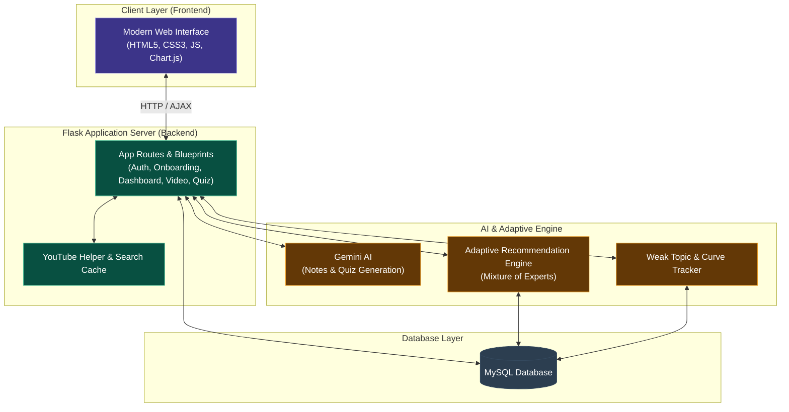
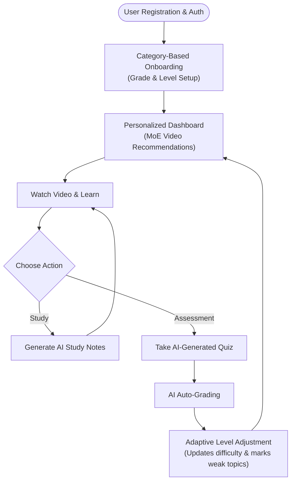
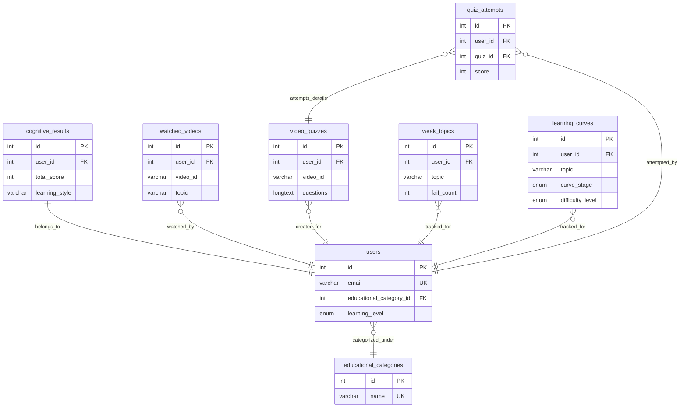

# 📊 AI Learning Platform — System Architecture, Flowchart & ER Diagram

This document outlines a simplified system architecture, user flowchart, and database Entity-Relationship (ER) diagram for the **AI-Powered Personalized Learning Platform**.

---

## 1. System Architecture

The application is designed using a multi-tiered architecture consisting of the Presentation (Frontend), Logic (Flask backend), AI & Adaptive Engine, and Database layers.

---

## 2. User & System Flowchart

A streamlined look at the core user lifecycle:

---

## 3. Database Entity-Relationship (ER) Diagram

A high-level ER Diagram showing the core tables, primary/foreign keys, and relationships.

